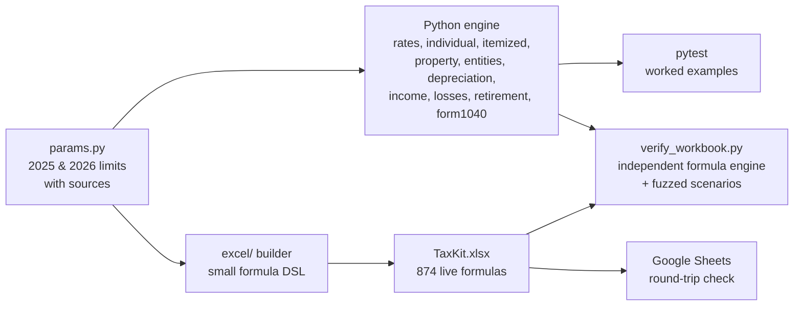

# TaxKit

**A tested U.S. federal tax engine for 2025–2026 (post-OBBBA). It ships as four downloadable Claude skills, a
business tax opportunity scanner, and a formula-driven Excel / Google Sheets workbook.**

[](https://github.com/matveygreschner/taxkit/actions/workflows/ci.yml)
[](https://github.com/matveygreschner/taxkit/releases)

TaxKit computes U.S. federal income tax the way the Code and the IRS forms do, and every result is
checked by an automated test suite. The rules live in one tested Python engine. The same engine generates a
formula-driven Excel / Google Sheets workbook, scans businesses for tax planning opportunities, and powers
Claude skills, so an AI assistant does exact tax math and cites authority instead of guessing.

## Claude skills (download)

| Skill | What it does | Download |
|---|---|---|
| **us-tax-calculator** | 60+ exact calculations: bracket tax and capital gains, full Form 1040, Schedule A / SALT cap, SE and payroll tax, credits, kiddie tax, basis and gains, entities and DRD, MACRS / §179 / bonus, income items, losses, IRA / SEP. It can also generate the workbook. | [zip](https://github.com/matveygreschner/taxkit/releases/latest/download/us-tax-calculator.zip) |
| **business-tax-optimizer** | Scans a company profile against 20 current-law opportunities and ranks them by estimated dollar value, with assumptions, action steps and citations. Includes an entity-choice model with a full §199A computation. | [zip](https://github.com/matveygreschner/taxkit/releases/latest/download/business-tax-optimizer.zip) |
| **estimated-tax-planner** | §6654 safe harbors (90% / 100% / 110%), the Form 2210 penalty ledger at the real quarterly IRS rates (each payment applied to the oldest shortfall, interest split at rate changes, IRC 7503 holiday shifts), 1040-ES vouchers, and a year-end projection that ranks the fixes (W-4 withholding, Jan 15 payment, IRA withholding rolled over or kept) by net benefit. It refuses to guess unannounced rates. | [zip](https://github.com/matveygreschner/taxkit/releases/latest/download/estimated-tax-planner.zip) |
| **tax-memo-writer** | Writes Facts / Issue / Conclusion / Analysis tax memos, with authority ranked correctly, confidence standards (substantial authority, more likely than not) and computations from the other two skills. | [zip](https://github.com/matveygreschner/taxkit/releases/latest/download/tax-memo-writer.zip) |

**Install:**
- **Claude.ai / Claude desktop:** Settings → Capabilities → Skills → upload the zip.
- **Claude Code:** unzip into `~/.claude/skills/` (or a project's `.claude/skills/`).
- **API:** upload through the Skills API.

The code skills bundle their own copy of the engine and need only Python 3.9+ (the standard library;
`openpyxl` for Excel output).

Try prompts like:
- "It's late November. Will we owe an underpayment penalty, and what's the cheapest fix before year-end?"
- "We file jointly, $185K wages, $30K LTCG, two kids — what do we owe for 2026?"
- "I own an S corp machine shop doing $4.2M revenue… what tax savings am I missing?"
- "Write a memo on whether Jordan's S corp distribution is taxable."

## Live data

`sec_tax_profile` turns SEC XBRL facts (from any connected filings tool) into a checked income-tax profile:
- effective rate, checked against the company's tagged rate;
- current vs. deferred tax;
- valuation-allowance and unrecognized-benefit trends;
- ASC 740 / ASU 2023-09 flags.

It's tested on Apple's 10-K filed 2026-11-03. `underpayment_rate` serves the dated IRC 6621 table and
accepts live overrides from irs.gov. Every figure carries its source and date.

## Roadmap

[`docs/ROADMAP.md`](docs/ROADMAP.md) has the plan for the next skills: the estimated-tax planner (shipped),
an ASC 740 provision engine, and a retirement distribution planner. A 16-agent adversarial
tournament chose them against a market survey of existing tax skills.

## Business tax optimizer

`business_scan` takes a company profile (entity, receipts, profit, owner pay, assets, R&D, interest, benefits, exit
plans) and runs these checks:

| Area | Checks (2025–2026 law, P.L. 119-21) |
|---|---|
| Structure | Entity choice (combined entity + owner tax, payroll, full §199A), S corp reasonable salary sweep, QBI wage/SSTB limits and 2026 $400 minimum |
| Cost recovery | 100% bonus (post-1/19/2025), §179 ($2.56M / $4.09M), cost segregation, §168(n) manufacturing buildings |
| R&D | §174A domestic expensing and the 2022–24 catch-up (and the closed July 6, 2026 retroactive window), §41 ASC credit with the 79% §280C election and the $500K payroll offset |
| Financing & methods | §163(j) on EBITDA vs. EBIT, the $31M / $32M §448(c) small-business exemptions, cash-method change |
| State & benefits | PTET vs. the $40,400 SALT cap (owner's 1040 recomputed both ways), 401(k) plus §45E/§45T startup and contribution credits, §45F childcare (2026 50% / $600K), §45S paid leave |
| Exit | QSBS tiers (50/75/100% at 3/4/5 years, $15M cap, $75M assets), opportunity zones (2027 regime) |
| Watch list | WOTC lapse, closing §179D / §45L / §45Y-48E windows, corporate 1% charitable floor, 1099 thresholds |

```bash
PYTHONPATH=src python -m taxkit.api business_scan "{\"profile\": $(cat examples/acme_s_corp.json), \"format\": \"markdown\"}"
```

On the example S corp manufacturer it finds cost segregation, bonus depreciation, a new 401(k) with startup
credits, the research credit, a cash-method change and PTET. It says which are timing items (present value)
and which are permanent. The rules, dates and sources behind every check are in
[`skills/business-tax-optimizer/references/opportunities.md`](skills/business-tax-optimizer/references/opportunities.md).

## Workbook (Excel / Google Sheets)

[**Download the workbook**](workbook/TaxKit.xlsx) · open it in Excel, or in Google Sheets via *File → Import*.

**Two methods, one switch.** The `Start` sheet's **Method** dropdown picks which one every sheet uses.
**Law** (the default) is the statutory computation. **Simplified** applies common hand-computation
shortcuts, so you can compare a hand-worked answer with the statute and explain the difference.

---

### Sheets

| Sheet | Topic | What it computes |
|---|---|---|
| `Tax_Calc` | Brackets, capital gains | Rate-schedule tax, the simplified "pick smaller" method and the Schedule D Tax Worksheet side by side (0/15/20%, 25% §1250, 28% collectibles), bracket table |
| `Form_1040` | Tax formula | Gross income → AGI → standard vs. itemized → Schedule 1-A → QBI → tax + SE tax + 0.9% Medicare + NIIT − CTC/ACTC → refund |
| `Sch_A` | Itemized deductions | 7.5% medical floor, OBBBA SALT cap with 30% phase-down, $750K mortgage proration, investment interest, charity %-of-AGI limits and the 2026 0.5% floor, 90% gambling rule |
| `Payroll_SE` | Payroll / SE tax | Employer and employee FICA, wage base, Additional Medicare, Schedule SE and its ½ deduction, NIIT |
| `Std_Ded_Credits` | Filing, dependents | Standard deduction incl. dependent rule, kiddie tax (Form 8615), CTC/ODC/ACTC phase-out, senior / tips / overtime / car-loan deductions |
| `Capital` | Property transactions | Amount realized, adjusted basis, §121 (incl. partial), ST/LT netting with $3,000 limit and character-preserving carryforwards, stock splits/dividends, recourse vs. non-recourse foreclosure |
| `Entities` | Business entities | What the owner reports under sole prop / partnership / S corp / C corp; C corp TI with DRD (TI limitation), charitable limit, 80% NOL; double taxation |
| `Basis` | Partner / S corp basis | 8-year outside-basis roll-forward with distribution gain and suspended losses |
| `Depreciation` | Cost recovery | MACRS (IRS Pub. 946 tables) with §179 and bonus, mid-quarter test, mid-month real property, §179 phase-out and income limit, §195 start-up costs, §197, mileage |
| `Income_Items` | Inclusions / exclusions | Social Security two-tier inclusion, §7872 imputed interest, annuity exclusion ratio, group-term life Table I, FEIE proration, LTC per diem, scholarships, tax benefit rule, OID accrual |
| `Losses` | Losses | Casualty ($100 / 10% AGI, qualified disaster), §461(l) excess business loss, NOL computation and 80% limit, §280A vacation home (Tax Court *and* IRS allocation), hobby |
| `Retirement` | Retirement | Traditional IRA phase-out ($10 round-up, $200 minimum), spousal rule, Roth limit, SEP, 401(k) catch-ups |
| `Rates` / `Brackets` / `MACRS_Tables` | — | Every parameter for 2025 and 2026 with its IRC / Rev. Proc. source. One dropdown on `Start` switches the whole workbook between years. |

## How it's built



* **One source of truth.** `params.py` holds every bracket, limit and phase-out. Both the Python
  engine and the spreadsheet's `Rates`/`Brackets` sheets are generated from it.
* **Bracket math as a cumulative function.** Tax on income *x* is
  `SUMPRODUCT((x>Lower)*(x−Lower)*ΔRate)`. Tax on any slice of income is then a difference of two
  calls. That lets the spreadsheet stack ordinary income, 25% gain, 28% gain and 0/15/20% gain the
  way the Schedule D worksheet does, with no helper columns.
* **Portable formulas.** The builder uses only `SUMIFS`, `SUMPRODUCT`, `INDEX`/`MATCH`, `MIN`/`MAX`,
  `IF`, `ROUND`/`ROUNDUP`/`CEILING`. It avoids `XLOOKUP`, `LET`, dynamic arrays, Excel Tables,
  defined names and macros. A test fails the build if any of those appear.

## How it's verified

| Layer | What it checks | Result |
|---|---|---|
| `tests/test_business.py` | Hand-checked entity, §199A, §163(j), QSBS, §45F and scanner cases | all pass |
| `tests/test_estimates.py` | Form 2210 worked example to the cent ($110.63 / $0 / $70.19), safe-harbor boundaries and exceptions, status changes, holiday shifts, postponements, day counts, payment-order properties, remedy ranking | all pass |
| `tests/test_live.py` | SEC XBRL tax profile on real Apple 10-K data; rate overrides | all pass |
| `tests/test_skills.py` | Skills are valid, in sync with `src/`, and run from the unpacked zip in isolated mode | all pass |
| `tests/test_worked_examples.py` | 74 textbook-style worked problems across entities, basis, property transactions, income, deductions, losses, depreciation and retirement, in both methods where they differ | all pass |
| `scripts/verify_workbook.py` | Recalculates the spreadsheet with the independent [`formulas`](https://pypi.org/project/formulas/) engine and compares it with Python across fixed cases plus randomized 1040s and tax calculations | **1,457 comparisons, 0 mismatches** (`--fuzz 40`, both methods) |
| Google Sheets round-trip (`scripts/compare_export.py`) | Uploaded the .xlsx, converted it to a Google Sheet, exported Google's computed values, and diffed every formula cell | **874 / 874 cells identical, 0 errors, all 20 dropdowns kept** |
| Usage stats (`scripts/download_stats.py`, `.github/workflows/stats.yml`) | Records release downloads daily into `stats/downloads.csv` (and views/clones into `stats/traffic.csv` if a `TRAFFIC_TOKEN` secret is set) | — |
| CI (`.github/workflows/ci.yml`) | Runs all of the above on Python 3.10 and 3.13 on every push | — |

### Simplified method vs. the statute

| Topic | Simplified | Law (default) |
|---|---|---|
| Capital gains / qualified dividends | Each band taxed at the **smaller** of the ordinary and capital-gain rate: $400K LTCG, single 2026 → **$52,554.00** | Schedule D Tax Worksheet (IRC 1(h)) → $52,582.50 |
| Dividends received deduction (IRC 243) | 70% / 80% / 100% (pre-2018) | 50% / 65% / 100% (since 2018) |
| SEP deduction (IRC 404(h)) | 20% of net SE income | 20% of (net SE income − ½ SE tax) |

## Quick start

```bash
pip install -r requirements-dev.txt
python -m pytest -q                                   # worked examples + workbook checks
PYTHONPATH=src python -m taxkit build                 # regenerate workbook/TaxKit.xlsx
python scripts/verify_workbook.py --fuzz 40           # spreadsheet vs. engine
PYTHONPATH=src python -m taxkit tax 400000 --status S --ltcg 400000            # law method; add --method simplified
```

```python
from taxkit.form1040 import Return1040, compute_return
r = compute_return(Return1040(year=2026, status="MFJ", method="law", wages=150_000, qualifying_children=2,
                              itemized={"state_local_taxes": 18_000, "mortgage_interest": 14_000}))
for label, amount in r.lines:
    print(f"{label:32} {amount:>12,.2f}")
```

## Using the workbook

* **Yellow cells with blue text are inputs.** Everything else is a formula. Green-shaded rows are the answers.
* Pick the tax year and the method (Law / Simplified) once on `Start`. Every sheet follows.
* Each sheet opens pre-filled with a worked example, so you can see the expected format.
* **Google Sheets:** *File → Import → Upload* the .xlsx (or open it from Drive and choose *Save as Google Sheets*).

## Scope and limitations

Built for planning and learning, not filing. Some models are deliberate simplifications. Examples:

* QBI uses the at-or-below-threshold formula only (no W-2 wage/UBIA or SSTB limits).
* Charitable ordering is simplified to bucket caps plus a 60% overall cap.
* AMT, EITC and education credits are not modeled.
* Kiddie tax assumes one child and ordinary income only.

The 2026 LTC per-diem figure should be confirmed against the final Rev. Proc. **Not tax advice.**

## Project layout

```
src/taxkit/
  params.py          tax-year parameters (single source of truth)
  rates.py           brackets, Schedule D worksheet, simplified 'pick smaller' method
  individual.py      standard deduction, dependents, Sch. 1-A, CTC, kiddie tax, SS, QBI
  itemized.py        Schedule A
  payroll.py         FICA, SE tax, Additional Medicare, NIIT
  property.py        realized/recognized gain, netting, Sec. 121, basis rules
  entities.py        owner reporting, basis roll-forward, C corp / DRD
  depreciation.py    MACRS tables, Sec. 179, bonus, real property, amortization
  income.py          inclusions and exclusions
  losses.py          casualty, EBL, NOL, vacation home, hobby
  retirement.py      IRA, Roth, SEP
  form1040.py        end-to-end return
  api.py             JSON command interface (used by the skills)
  business/          opportunity scanner, entity model, business parameters, reports
  excel/             workbook builder (core DSL, reference sheets, calculators)
skills/              the three Claude skills (engine vendored by scripts/build_skills.py)
scripts/verify_workbook.py   spreadsheet vs. engine
scripts/compare_export.py    any app's recalculated export vs. engine
scripts/build_skills.py      vendor engine into skills, generate references, package dist/*.zip
tests/
workbook/TaxKit.xlsx
```

License: MIT.
